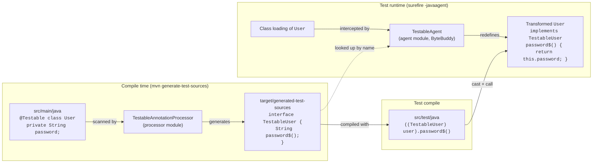

# Testable

Testable lets unit tests read the **private fields** of a class without changing the class itself, without reflection in the test code, and without touching production artifacts.

```java
@Testable
public class User {
    private String secretName;
    private String password;
}

// In a test
TestableUser testableUser = (TestableUser) new User("James Bond", "password007");
assertEquals("James Bond", testableUser.secretName$());
```

The test code is fully typed: field renames or type changes are compile errors in the tests, not runtime reflection failures.

## How it works

Testable has two parts:

1. **At compile time**, an annotation processor generates a `Testable<ClassName>` interface for each testable class or enum. The interface declares one getter-like method per field.
2. **At test runtime**, a Java agent rewrites each testable class as it is loaded so that it implements its generated interface. ByteBuddy generates the method bodies, and each one returns the value of its field.

The tests cast the object to the generated interface and call its methods.



### 1. Marking classes as testable

The `@Testable` annotation (`api` module) can be placed on:

- **a class or an enum**: that type becomes testable. Nested types must be annotated separately.
- **a package** (in `package-info.java`): every top-level class and enum of that package becomes testable.

A type annotated directly and also through its package gets only one interface. Classes in the default package are ignored, and the processor reports them with a `WARNING`.

### 2. Generating the interfaces (processor)

For each testable type, `TestableAnnotationProcessor` generates a public interface in the same package. The interface is named `Testable` followed by the type's binary name without the package, so nested types sharing a simple name never collide:

| Testable type      | Generated interface   |
|--------------------|-----------------------|
| `com.acme.Foo`     | `com.acme.TestableFoo`        |
| `com.acme.Box.Inner` | `com.acme.TestableBox$Inner` |
| `com.acme.Left.Node` / `com.acme.Right.Node` | `com.acme.TestableLeft$Node` / `com.acme.TestableRight$Node` |

The interface is annotated with `@TestableInterface("<binary name of the type>")`, which tells the agent which type it was generated for.

Each **non-static field declared by the type itself** becomes a method named `<field>$()` that returns the field's type:

| Field in `Foo`                    | Method in `TestableFoo`                                          |
|-----------------------------------|------------------------------------------------------------------|
| `private String name;`            | `java.lang.String name$();`                                      |
| `private int[][] grid;`           | `int[][] grid$();`                                               |
| `private List<? extends U> nums;` | `java.util.List<? extends U> nums$();`                           |
| `private T outerValue;` (in an inner class, `T` from the outer class) | `java.lang.Comparable outerValue$();` (erased) |

Generic classes keep their type parameters and bounds: `Box<T extends Comparable<T>, U, V>` becomes `TestableBox<T extends Comparable<T>, U, V>`.

**Ignored fields:**

- `static` fields.
- Fields inherited from superclasses. Annotate the superclass to test it.
- Fields whose type cannot be referenced from the generated interface, such as a `private` nested class, a local or anonymous class, or a non-public type from another package. The processor reports these with a `NOTE`.
- Fields whose type cannot be resolved. If another annotation processor might still generate the type, the class is deferred to a later round. If the type is still unresolved in the last round, the field is dropped with a `WARNING`.

### 3. Implementing the interfaces (agent)

`TestableAgent` is a `premain` Java agent built on ByteBuddy and shaded into a self-contained jar. It considers the same candidates as the processor: classes and enums annotated with `@Testable`, and top-level classes and enums of `@Testable` packages. For each candidate that is loaded, the agent:

1. derives the interface name using the processor's naming rule,
2. resolves that interface from the class's class loader,
3. skips the class without any output if the interface does not exist, or if its `@TestableInterface` marker names a different class. This is the case for test classes that live in a `@Testable` package,
4. makes the class implement the interface,
5. implements each `<field>$()` method as a direct read of the field `<field>`.

If a method has no matching field, the interface is out of date (for example, the class changed but the processor didn't run again). In that case the class is left untransformed, and the agent prints the reason on `System.err`:

```
[Testable] Failed to transform com.acme.User: java.lang.IllegalStateException: Field ghost not found in com.acme.User, com.acme.TestableUser is out of date: recompile the project
```

Pass `verbose` as the agent argument (`-javaagent:testable-agent.jar=verbose`) to also log each transformed class.

The interface must be added **before the class is loaded**, because the JVM does not let a retransformation change a class's hierarchy. This is why the agent must be attached with `-javaagent` and cannot be attached dynamically.

## Project layout

| Module       | Role                                                                     | Used by the application in      |
|--------------|--------------------------------------------------------------------------|---------------------------------|
| `api`        | The `@Testable` annotation, and the `@TestableInterface` marker put on generated interfaces | main code (compile scope)       |
| `processor`  | `TestableAnnotationProcessor`: generates the `Testable*` interfaces      | a dedicated compiler execution  |
| `agent`      | `TestableAgent`: ByteBuddy agent, shaded jar with `Premain-Class`        | surefire `-javaagent`           |
| `sample-app` | Standalone Maven project that demonstrates and tests the whole chain     | n/a                             |

## Using it in a Maven project

The `sample-app/pom.xml` file is the reference setup. It has four parts:

1. **Main compilation** stays unchanged and keeps its own annotation processors, such as Lombok.
2. **A second `maven-compiler-plugin` execution** runs in `generate-test-sources` with `<proc>only</proc>` and only the Testable processor. It writes the interfaces to `target/generated-test-sources`, so they never reach `target/classes` or the production jar.
3. **`build-helper-maven-plugin`** adds `target/generated-test-sources` as a test source root.
4. **`maven-dependency-plugin`** copies the agent jar to `target/libs/testable-agent.jar`, and **surefire** starts the test JVM with `-javaagent:${project.build.directory}/libs/testable-agent.jar`.

## Building

Testable requires Java 17 or later.

```shell
# 1. Build and install the library modules (api, processor, agent)
mvn install

# 2. Build and test the sample application
cd sample-app
mvn test
```

## Limitations

- Classes in the default package are not supported.
- Only classes and enums are supported. Records and interfaces are not.
- Enums and `final` classes must be cast through `Object`, as in `(TestableColor) (Object) Color.RED`. Otherwise javac rejects the cast, because it knows that such a type cannot implement the interface.
- Superclass fields are not exposed through the subclass's interface. Make the superclass `@Testable` instead.
- If the agent is missing from the test JVM, every cast to a `Testable*` interface fails with a `ClassCastException`.
