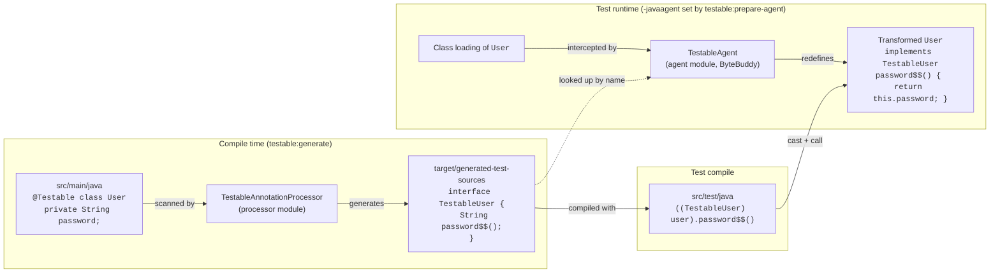

# Testable

Testable lets unit tests read the **fields** and call the **methods** of a class, whatever their visibility, without changing the class itself, without reflection in the test code, and without touching production artifacts.

```java
@Testable
public class User {
    private String secretName;
    private String password;

    private boolean checkPassword(String candidate) {
        return password.equals(candidate);
    }
}

// In a test
TestableUser testableUser = (TestableUser) new User("James Bond", "password007");
assertEquals("James Bond", testableUser.secretName$$());
assertTrue(testableUser.checkPassword$("password007"));
```

The test code is fully typed: renaming a member or changing a signature causes compile errors in the tests, not runtime reflection failures.

Tests can also follow references. When a field or a return type is annotated, its class becomes testable too, and the accessor returns that class's `Testable*` interface:

```java
@Testable
public class User {
    @Testable
    private Address address;   // Address itself is not annotated
}

// In a test
TestableAddress address = ((TestableUser) user).address$$();
assertEquals("Some Street", address.street$$());
```

## How it works

Testable has two parts:

1. **At compile time**, an annotation processor generates a `Testable<ClassName>` interface for each testable class. The interface declares one getter-like method per field, and one mirror method per method.
2. **At test runtime**, a Java agent rewrites each testable class as it is loaded so that it implements its generated interface. ByteBuddy generates the method bodies: each one returns the value of its field, or calls its method.

The tests cast the object to the generated interface and call its methods.



### 1. Making classes testable

The `@Testable` annotation (`api` module) makes a class **testable**. Only classes, records and enums can be testable, either top-level or static nested. The annotation can be placed on:

- **a class, a record or an enum**: it becomes testable.
- **a package** (in `package-info.java`): all its top-level classes, records and enums become testable. Interfaces are skipped, nested classes are not included, and subpackages are not concerned.
- **a non-static field of a testable class**: the field's class becomes testable too. For an array, this is the class of its elements (`User` for `User[][]`).
- **a type used in the type of such a field**, as a type-use annotation: `List<@Testable User> users` makes `User` testable. This works at any depth (`Map<String, List<@Testable User>>`) and in wildcard bounds.
- **a non-static method of a testable class, or a type within its return type**: the same, for the return type.
- **the superclass of a testable class**, as a type-use annotation in its `extends` clause: `class Cat extends @Testable Feline` makes `Feline` testable. Generic superclasses are allowed (`extends @Testable Box<String>`).

A class made testable through a field or a method is processed exactly as if it were annotated. Its own annotated fields and methods are followed in turn, so references can be chained across the compiled sources.

```java
@Testable
public record Order(String id, List<@Testable OrderLine> lines) {

    @Testable
    Customer customer() { ... }       // Customer becomes testable
}
```

The annotation has `SOURCE` retention. Classes from libraries can be made testable through a field or a method, but their own annotations are not followed. This naturally limits the chain to one level outside the compiled sources.

#### Compilation errors

The following uses of `@Testable` fail the `generate` goal with an error:

- on an interface, an annotation type, an inner (non-static nested) class, a local or anonymous class, or a class of the default package;
- on an enum constant, a static field or a static method;
- on a constructor, a parameter, a local variable, a type parameter, an `implements` or `throws` clause, a type argument of an `extends` clause, a cast, a `new`, or anywhere in a method body;
- on the members of interfaces, annotation types, inner classes and local classes.

A field, a return type or an `extends` clause can only make a class testable if that class could be testable itself. The following are errors:

- primitive types and `void`;
- type variables;
- interfaces and annotation types;
- generic classes through a field or a return type (`Box<User>`), including JDK collections (`List<User>`: annotate the type argument instead, `List<@Testable User>`);
- inner classes;
- classes of the JDK, recognized by their packages: `java.`, `javax.`, `jdk.`, `sun.`, and `com.sun.`;
- classes that the generated interface cannot reference, such as a `private` nested class.

Abstract classes are allowed. Their abstract methods are simply not exposed.

#### Warnings

An annotated field, method or superclass of a class that is **not** testable has no effect, and the processor reports it with a `WARNING`:

```java
public class Plain {             // not testable
    @Testable
    private Address address;     // WARNING: ignored
}
```

A type annotated directly, through its package, and through a field gets only one interface.

### 2. Generating the interfaces (processor)

For each testable class, `TestableAnnotationProcessor` generates a public interface in the same package. The interface is named `Testable` followed by the class's binary name without the package, so nested classes sharing a simple name never collide:

| Testable class     | Generated interface   |
|--------------------|-----------------------|
| `com.acme.Foo`     | `com.acme.TestableFoo`        |
| `com.acme.Left.Node` / `com.acme.Right.Node` | `com.acme.TestableLeft$Node` / `com.acme.TestableRight$Node` |

The interface is annotated with `@TestableInterface("<binary name of the class>")`, which tells the agent which class it was generated for.

#### Fields

Each **non-static field declared by the class itself**, whatever its visibility, becomes a method named `<field>$$()` that returns the field's type. The double `$` keeps field accessors apart from methods, which use a single `$`:

| Field in `Foo`                    | Method in `TestableFoo`                                          |
|-----------------------------------|------------------------------------------------------------------|
| `private String name;`            | `java.lang.String name$$();`                                      |
| `protected int count;`            | `int count$$();`                                                  |
| `private int[][] grid;`           | `int[][] grid$$();`                                               |
| `private List<? extends U> nums;` | `java.util.List<? extends U> nums$$();`                           |
| `private Address address;` (`Address` testable) | `com.acme.TestableAddress address$$();`             |
| `private List<Line> lines;` (`Line` testable)   | `java.util.List<com.acme.TestableLine> lines$$();`  |

In field and return types, testable classes are replaced by their interfaces, wherever they appear: directly, as array elements, or as type arguments. This applies to every testable class of the compilation, whether or not that field is annotated. The tests can then follow references without casting. To use the public methods of the real class, cast the result back to it.

Generic classes keep their type parameters and bounds: `Box<T extends Comparable<T>, U, V>` becomes `TestableBox<T extends Comparable<T>, U, V>`.

**Ignored fields:**

- Static fields.
- All the fields of records, which are already readable through their accessors.
- Inherited fields, which the interface of the testable direct superclass exposes (see [Inheritance](#inheritance)).
- Fields that hide an inherited field of another type, reported with a `WARNING`: the interface could not declare both accessors.
- Fields whose type cannot be referenced from the generated interface, such as a `private` nested class, a local or anonymous class, or a non-public class from another package. The processor reports these with a `NOTE`.
- Fields whose type cannot be resolved. If another annotation processor might still generate the type, the class is deferred to a later round. If the type is still unresolved in the last round, the field is dropped with a `WARNING`.

#### Methods

Each **non-static, non-abstract method declared by the class itself**, whatever its visibility, becomes a method with the same name followed by `$`, the same parameters (names included), and the same `throws` clause:

| Method in `Foo`                                                   | Method in `TestableFoo`                                                    |
|-------------------------------------------------------------------|----------------------------------------------------------------------------|
| `private int add(int a, int b)`                                   | `int add$(int a, int b);`                                                  |
| `String describe()`                                               | `java.lang.String describe$();`                                            |
| `private String format(int v)` / `private String format(String v)` | `java.lang.String format$(int v);` / `java.lang.String format$(java.lang.String v);` |
| `private <R extends Comparable<R>> R max(List<R> values)`         | `<R extends java.lang.Comparable<R>> R max$(java.util.List<R> values);`   |
| `private int sum(int... values)`                                  | `int sum$(int... values);`                                                 |
| `private int parse(String s) throws IOException`                  | `int parse$(java.lang.String s) throws java.io.IOException;`              |
| `private void fail() throws SecretException` (private exception)  | `void fail$() throws java.lang.Exception;` (closest accessible superclass) |
| `Customer customer()` (`Customer` testable)                       | `com.acme.TestableCustomer customer$();`                                   |

Parameter types are never replaced by `Testable*` interfaces: tests pass real objects, and the agent finds the method by its erased parameter types.

Exceptions thrown by the method propagate unchanged, with no `InvocationTargetException` wrapping.

**Ignored methods:**

- Static methods, abstract methods, constructors, and methods declared in enum constant bodies.
- Inherited methods, and methods overriding them, which the interface of the testable direct superclass exposes (see [Inheritance](#inheritance)).
- Methods with the same name and erased parameter types as an inherited method they do not override, but another return type, reported with a `WARNING`.
- Methods generated by the compiler: `values()` and `valueOf()` of enums, and the accessors, `equals()`, `hashCode()` and `toString()` of records when they are not written in the source. Explicitly written record accessors are ignored too, like record fields.
- Methods whose return or parameter types cannot be referenced from the generated interface (same rules as fields), reported with a `NOTE`.
- Methods with a parameter typed by a type variable whose bounds cannot be expressed in the interface, such as `<K extends PrivateKey> void take(K key)`. The interface's parameter types would erase differently from the class's, and the agent finds the method by its erased parameter types. These are reported with a `NOTE`.
- Methods whose signature cannot be resolved, handled like fields (deferred, then dropped with a `WARNING`).

#### Inheritance

The interface of a testable class extends the interface of its **direct superclass**, if that superclass is testable, so the inherited fields and methods are reachable from the subclass interface:

```java
@Testable
public class Animal<T> { private T food; protected String sound() { ... } }

@Testable
public class Mammal<F> extends Animal<F> { private int legs; }

@Testable
public class Dog extends Mammal<Bone> { private String name; @Override protected String sound() { ... } }

// Generated
public interface TestableMammal<F> extends TestableAnimal<F> {
    int legs$$();
}
public interface TestableDog extends TestableMammal<Bone> {
    java.lang.String name$$();
}
```

- If a type argument of the superclass cannot be referenced from the interface (a private class of the enclosing class, for a nested class), the interface extends nothing: a `WARNING`, or an error for a superclass opted in with `extends @Testable`.
- Only the direct superclass is considered. If it is not testable, the interface extends nothing, even if a higher superclass is testable: a superclass that is not testable breaks the chain.
- Superclasses are never made testable implicitly: annotate them, or opt them in from the subclass with a type-use annotation on its `extends` clause:

  ```java
  @Testable
  public class Dog extends @Testable Mammal<Bone> { ... }   // Mammal becomes testable
  ```

  The superclass must meet the criteria of testable classes: a superclass from the JDK, an inner class or a class of the default package is a compilation error.
- The superclass must be testable in the same compilation. A superclass compiled in another module or a library is not linked, because the annotations of its sources are not visible, unless it is opted in with `extends @Testable`.
- Methods overriding an inherited method are not redeclared: the inherited interface method calls the override, by dynamic dispatch.
- The agent implements each interface in its own class: `Animal` implements `TestableAnimal` and reads its own private fields, and `Dog` inherits these implementations.

### 3. Implementing the interfaces (agent)

`TestableAgent` is a `premain` Java agent built on ByteBuddy and shaded into a self-contained jar. `@Testable` is not kept in the class files, so the agent finds testable classes through their generated interfaces. For each class that is loaded, the agent:

1. skips the class if it is loaded by the bootstrap class loader, if it is an interface, an anonymous, local or synthetic class, or if it belongs to the default package or to a JDK package,
2. derives the interface name using the processor's naming rule, and skips the class if the class loader has no such class file,
3. skips the class if the interface's `@TestableInterface` marker names a different class,
4. makes the class implement the interface,
5. implements each interface method:
   - `<name>$$()` becomes a direct read of the non-static field `<name>` (`FieldAccessor`),
   - `<name>$(...)` calls the non-static method `<name>` with the same erased parameter types (`MethodCall`).

   Values are cast to the interface's return types, which may be `Testable*` interfaces: their classes implement them at runtime.

If an interface method has no matching field or method, the interface is out of date (for example, the class changed but the processor didn't run again). In that case the class is left untransformed, and the agent prints the reason on `System.err`:

```
[Testable] Failed to transform com.acme.User: java.lang.IllegalStateException: No method matching public abstract int com.acme.TestableUser.ghost$(int) in com.acme.User, com.acme.TestableUser is out of date: recompile the project
```

Pass `verbose` as the agent argument (`-javaagent:testable-agent.jar=verbose`, or `-Dtestable.verbose` with the Maven plugin) to also log each transformed class.

The interface must be added **before the class is loaded**, because the JVM does not let a retransformation change a class's hierarchy. Attaching the agent with `-javaagent` guarantees that it is active before any class is loaded. It does not support dynamic attachment.

## Project layout

| Module         | Role                                                                                         | Used by the application in |
|----------------|----------------------------------------------------------------------------------------------|----------------------------|
| `api`          | The `@Testable` annotation, and the `@TestableInterface` marker put on generated interfaces | main code (compile scope)  |
| `processor`    | `TestableAnnotationProcessor`: generates the `Testable*` interfaces                          | the Maven plugin           |
| `agent`        | `TestableAgent`: ByteBuddy agent, shaded jar with `Premain-Class`                            | the Maven plugin           |
| `maven-plugin` | `testable-maven-plugin`: runs the processor and attaches the agent to the tests              | the build                  |
| `sample-app`   | Standalone Maven project that demonstrates and tests the whole chain                         | n/a                        |

## Using it in a Maven project

Declare the `api` dependency, and add the `testable-maven-plugin` with its two goals:

```xml
<dependencies>
    <dependency>
        <groupId>net.mokatech.testable</groupId>
        <artifactId>api</artifactId>
        <version>${lib.testable.version}</version>
    </dependency>
</dependencies>

<build>
    <plugins>
        <plugin>
            <groupId>net.mokatech.testable</groupId>
            <artifactId>testable-maven-plugin</artifactId>
            <version>${lib.testable.version}</version>
            <executions>
                <execution>
                    <goals>
                        <goal>generate</goal>
                        <goal>prepare-agent</goal>
                    </goals>
                </execution>
            </executions>
        </plugin>
    </plugins>
</build>
```

The rest of the build, including the application's own annotation processors such as Lombok, stays unchanged.

### `generate` goal

The `generate` goal runs in `generate-test-sources` by default. It runs javac over the main sources with `-proc:only` and the Testable processor alone, using the project's compile classpath, `maven.compiler.release` and source encoding. The interfaces are written to `target/generated-test-sources/testable` and added to the test sources. They never reach `target/classes` or the production jar. Misplaced `@Testable` annotations fail this goal.

Only problems are reported by default. With `-Dtestable.verbose`, the processor also reports each generated interface (processor option `-Atestable.verbose`, for builds without the plugin).

The output directory is emptied first, so interfaces of deleted classes do not linger. It must not be `generated-test-sources/test-annotations`, because `testCompile` empties that directory before compiling.

Maven must run on a JDK, not a JRE.

### `prepare-agent` goal

The `prepare-agent` goal runs in `initialize` by default. It takes the agent jar from the plugin's own dependencies and appends `-javaagent:<agent jar>` to the `argLine` property, which Surefire and Failsafe use by default to start the test JVM. The application doesn't need to declare the agent.

If the build configures its own `argLine`, for example for JaCoCo, that `argLine` must include the property: `<argLine>@{argLine} -Xmx1g</argLine>`. Otherwise it replaces the agent option, and every cast to a `Testable*` interface fails.

### Options

| Parameter         | User property      | Default                                                | Goal            | Description                                   |
|-------------------|--------------------|--------------------------------------------------------|-----------------|-----------------------------------------------|
| `skip`            | `testable.skip`    | `false`                                                | both            | Skips the goal                                |
| `outputDirectory` |                    | `${project.build.directory}/generated-test-sources/testable` | `generate`      | Where the interfaces are generated            |
| `verbose`         | `testable.verbose` | `false`                                                | both            | Makes the processor report each generated interface, and the agent log each transformed class |
| `propertyName`    |                    | `argLine`                                              | `prepare-agent` | Property that receives the `-javaagent` option |

### Without the plugin

`sample-app/pom-noplugin.xml` shows the same setup with standard plugins only:
- a second `maven-compiler-plugin` execution for the processor,
- `build-helper-maven-plugin` for the test source root,
- `maven-dependency-plugin`'s `properties` goal for the agent jar's path,
- a surefire `argLine`.

## Building

Testable requires Java 17 or later.

```shell
# 1. Build and install the library modules (api, processor, agent, maven-plugin)
mvn install

# 2. Build and test the sample application
cd sample-app
mvn test
```

## Limitations

- Classes in the default package are not supported.
- Interfaces, annotation types, inner (non-static nested), local and anonymous classes are not supported.
- Enums, records and `final` classes must be cast through `Object`, as in `(TestableColor) (Object) Color.RED`. Otherwise javac rejects the cast, because it knows that such a type cannot implement the interface.
- Static fields and methods are not exposed.
- Members of superclasses that are not testable are not exposed. Make the superclass testable (or opt it in with `extends @Testable`) to reach them.
- Non-private methods are called like the code under test would call them: if a subclass overrides the method, the override runs, even through the superclass's interface.
- When a testable class and its testable superclass both declare a field with the same name and type, or a private method with the same signature, the subclass interface redeclares it, and both interfaces reach the subclass's member on a subclass instance: the inherited member cannot be read on such instances. The processor reports it with a `WARNING`. With another type, the subclass's member is not exposed, also with a `WARNING`. Hiding inherited fields and shadowing inherited methods is a bad practice anyway.
- Field and method names ending with `$` are not supported: a method `legacy$()` would become `legacy$$()`, which reads as the accessor of a field `legacy`.
- The processor requires javac, whose syntax trees it uses to report misplaced annotations. With another compiler, misplaced annotations are not reported, and the processor says so with a `WARNING`.
- For a record from a library made testable, the compiler-generated `equals()`, `hashCode()` and `toString()` cannot be told apart from written ones, so they are exposed.
- The JDK packages are excluded by prefix, so non-JDK `javax.*` packages (such as `javax.persistence`) cannot be made testable either.
- Making a library class testable generates its interface in the library's package. This fails if the library jar is sealed or signed, or if the library is a named module on the module path. Remove the annotation in that case.
- If a module and a module that depends on it both make the same class testable, each generates its own interface for it, possibly with different contents (the annotations of the class are only visible to the module that compiles it). Both interfaces must not be on the same test classpath, which happens when one module's test-jar is a dependency of the other.
- If the agent is missing from the test JVM, every cast to a `Testable*` interface fails with a `ClassCastException`.
